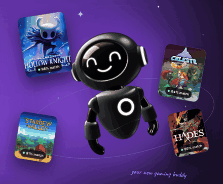
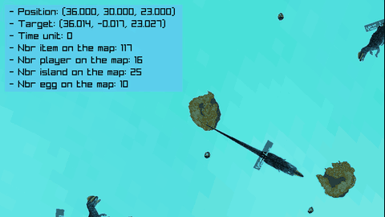
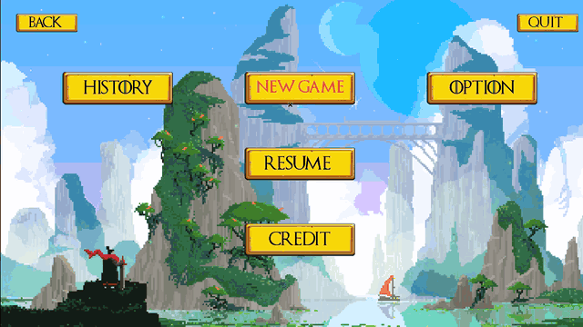

**[LinkedIn](https://www.linkedin.com/in/eva-legrand/)** &nbsp;·&nbsp; [PlayForward](https://playforward.fr) &nbsp;·&nbsp; [GitHub](https://github.com/Chaegnal)

I am Eva, a 5th-year software engineering student at [Epitech Paris](https://www.epitech.eu/) (class of 2027).

I like systems where many things happen at once: a game server juggling a dozen AI players, a core that swaps graphics libraries while the game runs, a back end talking to fifteen third-party APIs. Most of my projects are some version of that.

&nbsp;

## What I work on

|  |  |
|---|---|
| **Back end** | REST APIs in Go and TypeScript (Express), layered architecture, OAuth2, PostgreSQL |
| **Front end** | React and TypeScript |
| **Architecture** | Microservices, routing and gateway, Docker |
| **Systems and games** | C and C++, ECS engines, UDP and TCP networking, multithreading and processes |
| **Quality** | Unit tests, CI with GitHub Actions, conventional commits |

&nbsp;

## Stack

&nbsp;&nbsp;

&nbsp;&nbsp;

&nbsp;

## Building right now

**[PlayForward](https://playforward.fr)** is an indie game discovery platform that ranks games by what you play, how long you play them and what you tell it, never by ad budget. Its slogan is *Search less, play more*.

- **Back end:** the communities service, with type boundaries and routing behind the gateway
- **Product:** A/B testing the slogan with a survey before locking the wording
- **Stack:** TypeScript and Express services on a microservices platform, React on the front

&nbsp;

## Selected projects

<h3><a href="https://github.com/Chaegnal/area">AREA</a></h3>
Go · React · Flutter · PostgreSQL · Docker  
Workflow automation in the style of Zapier. Connect GitHub, Spotify, Discord or Reddit and chain &quot;when this happens, do that&quot;. A web client and a mobile app share one API.  
<b>My part:</b> the Go back end (684 of ~2,000 commits): layered architecture, OAuth2 services and the unit tests.
 
 

<h3><a href="https://github.com/Chaegnal/r-type">R-Type</a></h3>
C++ · ECS · Asio · raylib · CMake  
A multiplayer shoot'em up on a home-made ECS engine and a UDP server: four players against waves and bosses.  
<b>My part:</b> game logic, level switching, the level 2 and 3 bosses, firing systems and server threading (123 of 745 commits).
 
 

<h3><a href="https://github.com/Chaegnal/Zappy">Zappy</a></h3>
C · C++ · raylib · TCP  
AI teams survive and evolve on a shared map. A C server, C++ AI clients and a 3D viewer where the players fly over the islands.  
<b>My part:</b> server commands (look, broadcast, the graphical protocol), the win condition and tests (112 of 527 commits).
 
 

<h3><a href="https://github.com/Chaegnal/Arcade">Arcade</a></h3>
C++ · SFML · SDL2 · ncurses  
A retro gaming platform where games and graphics libraries are plugins loaded at runtime, so any game runs on any renderer.  
<b>My part:</b> the three graphics libraries, Pacman, Nibbler and the menu (35 of 72 commits, shared with one teammate).
 
 

<h3><a href="https://github.com/Chaegnal/RPG">Dragon Burden</a></h3>
C · CSFML  
A top-down RPG written in C during my first year, with a village, a quest line and an inventory. Team of four.  
<b>My part:</b> menus, maps, quests and inventory (18 commits).
 
 

<h3><a href="https://github.com/Chaegnal/My-Teams">My Teams</a></h3>
C · TCP · POSIX  
A Teams-style chat. One server handles many clients at once: teams, channels, threads and private messages, saved to disk.  
<b>My part:</b> the server command layer, user and team commands, and persistence (26 of 81 commits).
 
 

**Also:** [Raytracer](https://github.com/Chaegnal/Raytracer) (C++20 ray tracer with a scene parser) · [The Plazza](https://github.com/Chaegnal/The-Plazza) (pizzeria simulation with processes, IPC and thread pools) · [Image Compressor](https://github.com/Chaegnal/Image-Compressor) (k-means in Haskell)

&nbsp;

## Open source

I wrote the **`organizer`** realm for [gnolang/gno](https://github.com/gnolang/gno), a smart-contract platform written in Gno (an interpreted Go). It lets friends plan outings, with groups, hangouts, tests and documentation. About 100 commits between April and July 2025, including security fixes and filetests. [My fork](https://github.com/Chaegnal/gno).

&nbsp;

## Let's talk

If you want to talk back ends, game engines, or why a game recommendation should never be a paid placement, **[LinkedIn](https://www.linkedin.com/in/eva-legrand/)** is the fastest way to reach me.
