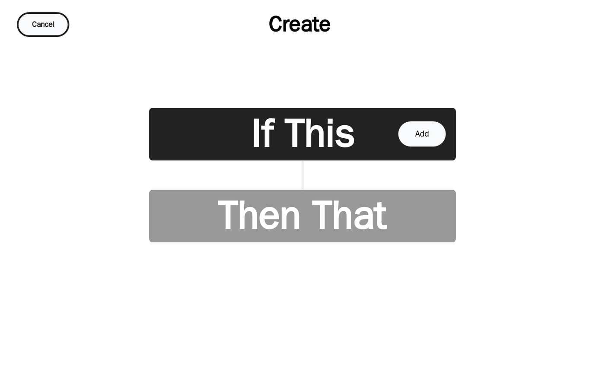

**5th-year software engineering student at [Epitech Paris](https://www.epitech.eu/) · class of 2027**

---

## 👩‍💻 About me

I'm a software engineer in my final years at Epitech. The curriculum took me through low-level work (C, C++, systems) as much as modern web architecture, and I like understanding **how things work underneath** just as much as shipping something people actually use.

Right now I'm working on **[PlayForward](https://playforward.fr)**, a game discovery platform: search less, play more.

## 🚀 What I do

- **Back-end:** REST APIs in Go and TypeScript / Express, layered architecture, OAuth2, PostgreSQL
- **Front-end:** React and TypeScript interfaces
- **Architecture:** microservices platform, routing and gateway, Docker containers
- **Systems and games:** C++ ECS engine, UDP client / server networking, multithreading
- **Quality:** unit tests and mocks, CI with GitHub Actions, conventional commits

## 🧰 My stack

## 🗂️ Projects

### 🔗 AREA: workflow automation, Zapier-style
*Go · React · Flutter · PostgreSQL · Docker — team of 4, 2024-2025*

Connect your accounts (GitHub, Spotify, Discord, Reddit…) and build workflows: "when this happens here, do that over there". About fifteen services, with a web client and a mobile app on the same API.

 

**My part:** the Go back-end, 684 of roughly 2,000 commits. Layered architecture, OAuth2 services (Reddit, Dropbox, LinkedIn, Asana, Discord…) and over 220 unit-test commits.

➡️ [See the project](https://github.com/Chaegnal/area)

### 🚀 R-Type: a multiplayer shoot'em up on a custom engine
*C++ · ECS · Asio · raylib · CMake — team of 5, 2024*

A from-scratch R-Type clone with a home-made ECS engine and a UDP game server: up to 4 players against waves of enemies and bosses.

**My part:** game logic on the ECS side: level switching, the level 2 and 3 bosses (including a four-ship final boss), firing systems, and server-side threading. 123 of 745 commits.

➡️ [See the project](https://github.com/Chaegnal/r-type)

### 🌐 Gno.land: open-source contribution
*Gno · smart contracts — 2025*

Contribution to [gnolang/gno](https://github.com/gnolang/gno), the smart-contract platform written in Gno (an interpreted Go). I wrote the **`organizer`** realm, which lets friends plan outings: friend groups and hangouts, with tests and documentation. About 100 commits between April and July 2025, including security fixes (private functions, address validation) and filetests.

➡️ [My fork](https://github.com/Chaegnal/gno)

### 🎮 PlayForward: in progress
*TypeScript · Express · React · microservices*

The game discovery platform I'm currently working on: [playforward.fr](https://playforward.fr).

## 📫 Get in touch

Built with care, and a bit too much coffee ☕

