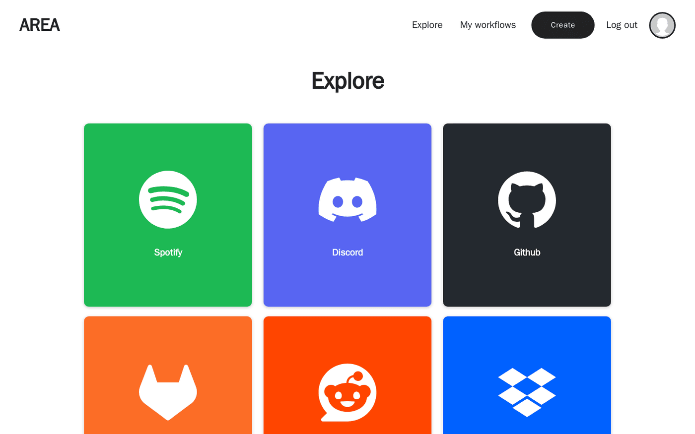
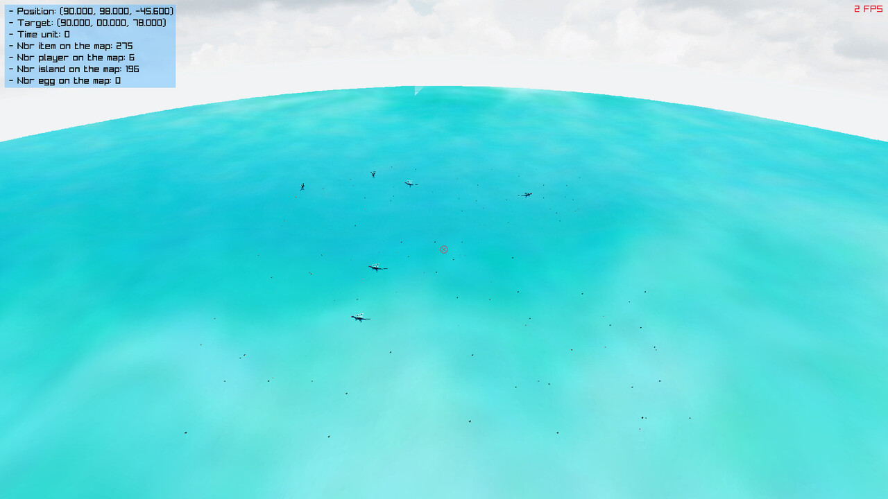

**[LinkedIn](https://www.linkedin.com/in/eva-legrand/)** &nbsp;·&nbsp; [PlayForward](https://playforward.fr) &nbsp;·&nbsp; [GitHub](https://github.com/Chaegnal)

I am a 5th-year software engineering student at [Epitech Paris](https://www.epitech.eu/), graduating in 2027. The curriculum took me from low-level C and C++ to modern web architecture, and I like both ends: understanding how things work underneath, and shipping something people use.

I am currently working on **[PlayForward](https://playforward.fr)**, a game discovery platform. *Search less, play more.*

&nbsp;

## What I work on

|  |  |
|---|---|
| **Back end** | REST APIs in Go and TypeScript (Express), layered architecture, OAuth2, PostgreSQL |
| **Front end** | React and TypeScript |
| **Architecture** | Microservices, routing and gateway, Docker |
| **Systems and games** | C and C++, ECS engines, UDP and TCP networking, multithreading and processes |
| **Quality** | Unit tests, CI with GitHub Actions, conventional commits |

&nbsp;

## Stack

&nbsp;&nbsp;

&nbsp;&nbsp;

&nbsp;

## Selected projects

<table>
<tr>
<td width="50%" valign="top">

<h3>AREA</h3>
Go · React · Flutter · PostgreSQL · Docker 
Workflow automation in the style of Zapier: connect GitHub, Spotify, Discord or Reddit and chain "when this, do that". A web client and a mobile app on one API.  
<b>My part:</b> the Go back end (684 of ~2,000 commits), layered architecture, OAuth2 services and the unit tests.
</td>
<td width="50%" valign="top">

<h3>R-Type</h3>
C++ · ECS · Asio · raylib · CMake 
A multiplayer shoot'em up on a home-made ECS engine and a UDP server: four players against waves and bosses.  
<b>My part:</b> game logic, level switching, the level 2 and 3 bosses, firing systems and server threading (123 of 745 commits).
</td>
</tr>
<tr>
<td width="50%" valign="top">

<h3>Zappy</h3>
C · C++ · raylib · TCP 
A network game where AI teams survive and evolve on a shared map: C server, C++ AI clients, 3D viewer.  
<b>My part:</b> server commands (look, broadcast, graphical protocol), win condition and tests (112 of 527 commits).
</td>
<td width="50%" valign="top">

<h3>Arcade</h3>
C++ · SFML · SDL2 · ncurses 
A retro gaming platform where games and graphics libraries are plugins loaded at runtime, so any game runs on any renderer.  
<b>My part:</b> the three graphics libraries, Pacman and Nibbler, and the menu (35 of 72 commits, shared with one teammate).
</td>
</tr>
<tr>
<td width="50%" valign="top">

<h3>Dragon Burden</h3>
C · CSFML 
A top-down RPG written in C in my first year, with a village, quests and an inventory. A team of four.  
<b>My part:</b> menus, maps, quests and inventory (18 commits).
</td>
<td width="50%" valign="top">

<h3>My Teams</h3>
C · TCP · POSIX 
A Teams-style chat: a server handling many clients at once, teams, channels, threads and private messages, with persistence.  
<b>My part:</b> the server command layer, user and team commands, and persistence (26 of 81 commits).
</td>
</tr>
</table>

**Also:** [Raytracer](https://github.com/Chaegnal/Raytracer) (C++20 ray tracer with a scene parser) · [The Plazza](https://github.com/Chaegnal/The-Plazza) (pizzeria simulation with processes, IPC and thread pools) · [Image Compressor](https://github.com/Chaegnal/Image-Compressor) (k-means in Haskell)

&nbsp;

## Open source

I wrote the **`organizer`** realm for [gnolang/gno](https://github.com/gnolang/gno), a smart-contract platform written in Gno (an interpreted Go). It lets friends plan outings, with groups, hangouts, tests and documentation. About 100 commits between April and July 2025, including security fixes and filetests. [My fork](https://github.com/Chaegnal/gno).

&nbsp;

## Let's talk

Open to chat about software engineering, PlayForward, or work.
**[Message me on LinkedIn](https://www.linkedin.com/in/eva-legrand/)**
